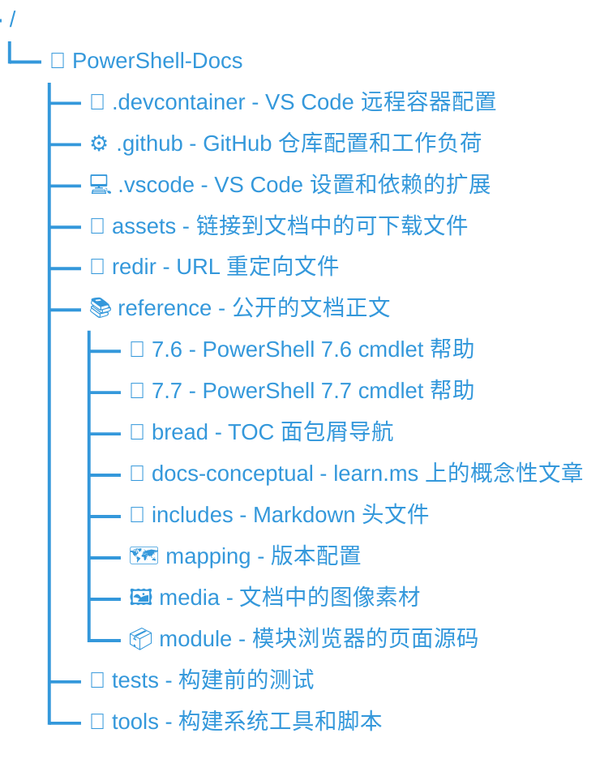

**简体中文** | [English](README-en_US.md)

# PowerShell 文档

欢迎来到 PowerShell-Docs 仓库。

## Microsoft 开源行为准则

此项目采用 [Microsoft Open Source Code of Conduct][04] 行为准则。

## PowerShell 可更新帮助 (CabGen) CI 构建状态

[![构建状态][CabGen 状态]][CabGen 构建历史]

[CabGen 状态]: https://apidrop.visualstudio.com/Content%20CI/_apis/build/status/PROD/CabGen(PowerShell_Updatable_Help)/GitHub_MicrosoftDocs_PowerShell-Docs/6ff7e8c3-dfc6-3ebd-da5a-d5e2ff43de8f_cabgen_Publish-Updatable-Help?repoName=MicrosoftDocs%2FPowerShell-Docs&branchName=live
[CabGen 构建历史]: https://apidrop.visualstudio.com/Content%20CI/_build/latest?definitionId=5076&repoName=MicrosoftDocs%2FPowerShell-Docs&branchName=live

## 仓库结构

下面的列表说明了此仓库中的主要文件夹。

> [!NOTE]
> 参考内容（在按数字标记的文件夹中）不仅用来创建文档网站上的页面，还用于生成给 PowerShell 使用的
> 可更新帮助。在 `docs-conceptual` 文件夹中的文章只会被发布到文档网站。

## 贡献

**重要: 如需对官方仓库作贡献，请前往[MicrosoftDocs/PowerShell-Docs](https://github.com/MicrosoftDocs/PowerShell-Docs)。**

我们非常欢迎在 _main_ 分支中通过 Pull Request 向本仓库发布贡献。
请注意，我们在通过你的拉取请求前，你必须签署我们的[Contribution License Agreement][03]。这只需要签署一次。

你可以从 [Contributor's Guide][02] 中获取更多有关贡献的信息。贡献者指南包括如何贡献文档的详细
信息、建议的工具、风格和格式要求。请使用 Issue 和 Pull Request 模板来帮助文档在各个版本中保持一致。

## 许可条款

这个项目中有两个许可文件。[MIT License][05] 应用于这个仓库中的代码，[Creative Commons license][06]
应用于文档。

本仓库中文版基于 Microsoft 的 [PowerShell-Docs 仓库](https://github.com/MicrosoftDocs/PowerShell-Docs)
翻译和修改而来。原始文档内容采用 CC BY 4.0 许可（见 [LICENSE.md](LICENSE.md)）。

由 miaobobo0813 进行本地化修改。
翻译后的文档内容同样采用 CC BY 4.0 许可发布。

<!-- link references -->
[02]: https://aka.ms/PSDocsContributor
[03]: https://cla.microsoft.com/
[04]: CODE_OF_CONDUCT.md
[05]: LICENSE-CODE.md
[06]: LICENSE.md

